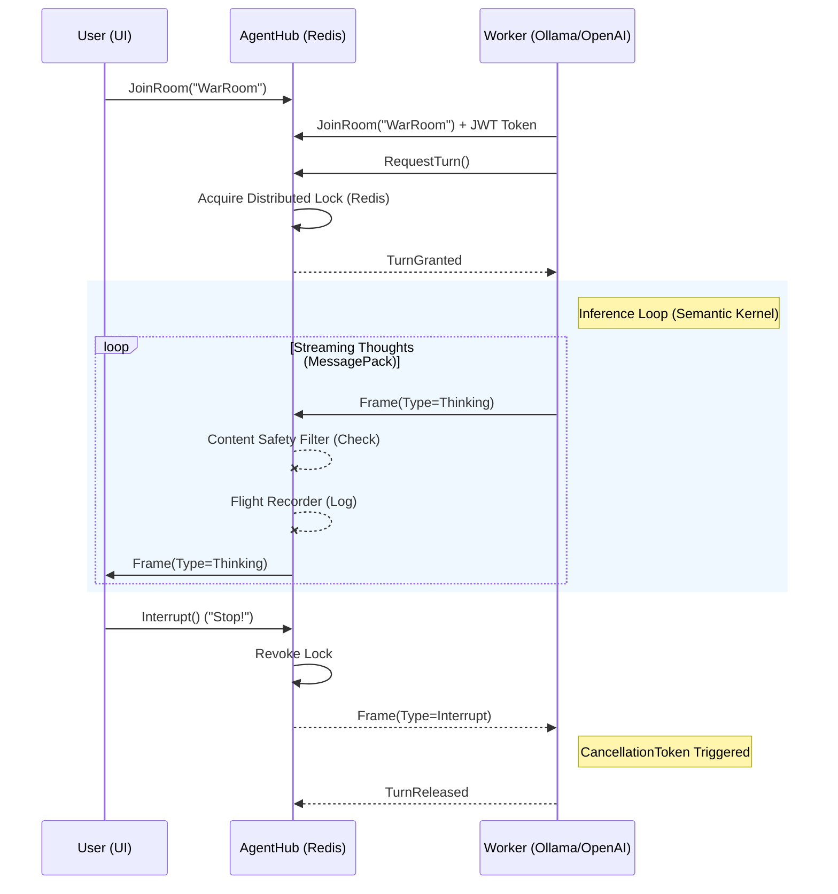

# AgentR 🧠⚡🛡️


**The Enterprise-Grade Real-time Protocol for Distributed AI Agents.**

AgentR is the "Nervous System" for multi-agent orchestration. It solves the hard distributed systems problems—concurrency, state synchronization, and remote interruptibility—so you can focus on building intelligent agents.

---

> **See also**: [Executive Summary](./docs/EXECUTIVE_SUMMARY.md) | [Technical Deep Dive](./docs/TECHNICAL_SUMMARY.md)

## 🌟 Why AgentR?

Most AI frameworks (Semantic Kernel, AutoGen) focus on the **Brain** (LLM reasoning). AgentR focuses on the **Network**.

| Feature | Description | Status |
| :--- | :--- | :--- |
| **Distributed Concurrency** | "Talking Stick" mutex backed by **Redis**. Reactive `FloorOpenFrame` signaling for sub-millisecond turn handoffs. | ✅ v1.1.0 |
| **Unique Identity** | **Phantom Agent Prevention**. Accurate `agentCount` via Redis Ref-counting and Set cardinality. | ✅ v1.1.0 |
| **Remote Interruptibility** | Stop runaway LLM loops instantly across the network via `CancellationToken` propagation. | ✅ v1.1.0 |
| **High Frequency** | Binary **MessagePack** protocol for 70% smaller payloads and sub-millisecond latency. | ✅ v1.1.0 |
| **Project Templates** | Scaffold enterprise-ready agents in seconds with `dotnet new agentr-worker`. | ✅ v1.1.0 |
| **Python Interop** | First-class support for Python agents via the reference `agentr` package. | ✅ v1.1.0 |
| **Enterprise Security** | JWT-based authentication and `[Authorize]` gateways for zero-trust orchestration. | ✅ v1.1.0 |
| **Governance** | "HR Department" filters to block PII, profanity, or sensitive topics at the network level. | ✅ v1.1.0 |
| **FinOps** | **Budget Controller**. Token-based quota management to prevent runaway AI costs. | ✅ v1.1.0 |
| **Flight Recorder** | **Audit & Compliance** engine. Immutable logs with cold storage (Azure Blob/S3). | ✅ v1.1.0 |
| **Cloud Native** | Built-in **.NET Aspire** orchestration for a unified local and cloud dev experience. | ✅ v1.1.0 |

---

## 🏗️ Architecture

AgentR decouples the **Hub** (State & Governance) from the **Workers** (Intelligence). This allows you to scale your agents independently of your orchestration logic.



---

## 🚀 Getting Started

Join the AgentR network in under 60 seconds.

### 1. Install & Scaffold
```bash
# Install the official template
dotnet new install ./templates/AgentR.Worker

# Scaffold a new agent 
dotnet new agentr-worker -n MyAgent

# Scaffold an ADVANCED agent (FinOps, MCP, KEDA)
dotnet new agentr-worker-advanced -n MyProAgent
```

### 🛡️ Reliability & Safety
AgentR now includes **Zombie Agent Protection**:
*   **Auto-Release SDK**: Both .NET and Python clients automatically release turns if your code crashes.
*   **Server WatchDog**: The Hub forcibly revokes locks after 60s (configurable via `AgentR:LeaseTimeoutSeconds`) if an agent hangs.

### 🔐 Authentication
AgentR supports **JWT-based authentication** for production deployments:

**For Local Development (Default):**
```json
{
  "AgentR": {
    "DisableAuth": true  // No authentication required
  }
}
```

**For Production:**
```json
{
  "AgentR": {
    "DisableAuth": false  // Enable JWT authentication
  }
}
```

When authentication is enabled, clients must provide a valid JWT token. See the [Authentication Guide](docs/AUTHENTICATION.md) for details on token generation and configuration.

### 2. Choose Your "Brain" (LLM-Agnostic)
AgentR is a transport layer. It doesn't care which LLM you use. The `agentr-worker` template comes pre-configured with:

| Provider | Integration Method |
| :--- | :--- |
| **Local LLM** | [Ollama](https://ollama.ai) (llama3.2, mistral, etc.) |
| **OpenAI** | GPT-4o, o1-preview |
| **Azure OpenAI** | Enterprise-grade deployments |
| **Anthropic** | Claude 3.5 Sonnet |
| **Custom** | Any LLM with a C# or Python SDK |

### 3. Launch the Stack
Use **.NET Aspire** to spin up Redis, the Hub, and your agent with one command:
```bash
dotnet run --project src/AgentR.AppHost/AgentR.AppHost.csproj
```

### 🎮 See it in Action

To experience the **Lobby Pattern** and **Scale-to-Zero** logic:
1. **Start the Aspire AppHost**.
2. Go to the **"Agent Lobby"** in the sidebar.
3. Click **"Summon DotNet Agent"** and watch the logs in your terminal!

---

## 📂 Project Ecosystem

*   **`src/AgentR.Client`**: High-performance .NET SDK.
*   **`src/AgentR.Server`**: The Hub with Redis backplane and Content Safety.
*   **`src/AgentR.Python`**: Native Python interop bridge.
*   **`samples/AgentR.Demo`**: A full-stack Aspire demo with a **Session Replay** portal.
*   **`docs/FLIGHT_RECORDER.md`**: Specs for the Auditing and Session Replay system.
*   **`docs/KEDA_AUTOSCALING.md`**: Guide for Scale-to-Zero and the Lobby Pattern.
*   **`docs/BUDGET_CONTROLLER.md`**: FinOps specs for Token-based Quota management.
*   **`docs/MCP_GATEWAY.md`**: Architecture for the secure Model Context Protocol gateway.

## 📘 Engineering Standards

We enforce strict coding standards to guarantee performance and stability:

*   **[ASP.NET Core Standards](./docs/DOTNET_STANDARDS.md)**: Zero-allocation, Async/Await best practices (`ValueTask`, `CancellationToken`).
*   **[Python SDK Standards](./docs/PYTHON_STANDARDS.md)**: Native AsyncIO, Strong Typing with `TypedDict`, and Awaitable Tool calls.

---

## 🛡️ Governance & Auditing

AgentR includes an enterprise-grade auditing engine designed for strictly regulated industries:

- 💸 **FinOps Budgeting**: "Toll Booth" pricing model for OpenAI/Anthropic costs.
- 🔌 **MCP Gateway**: Secure transport for Anthropic's Model Context Protocol.
- ⚡ **KEDA Scale-to-Zero**: Integrated with Kubernetes for event-driven agent scaling.
- **Immutable Log Trails**: Every frame (Thinking, Messaging, Turns) is captured and hashed.
- **Cold Storage**: Pluggable storage providers (Local File, Azure Blob, S3) for long-term retention.
- **Session Replay**: Watch conversation "tape" millisecond-by-millisecond to debug agent hallucinations.

**💡 TIP**
Check out the [Flight Recorder Documentation](./docs/FLIGHT_RECORDER.md) for technical deep-dives into the storage abstraction.

---

## 🚀 KEDA Autoscaling (Lobby Pattern)

AgentR supports event-driven autoscaling to zero for cost-efficient agent management:
1. **Lobby Queue**: The Hub pushes "tickets" to Redis when an agent type is requested.
2. **KEDA Scaler**: A `ScaledObject` monitors the Redis list length.
3. **Just-in-Time Provisioning**: Pods spin up to handle tickets and scale back to zero when idle.

**💡 TIP**
See `k8s/agentr-keda.yaml` for a reference implementation.

---

## 👩‍💻 Code Example: The Network-Aware Agent

Integrating AgentR with your agentic loop is as simple as passing a `CancellationToken`.

```csharp
client.OnTurnGranted += async (stopEvent) =>
{
    // 1. Call your Favorite LLM with the Network Signal
    var response = kernel.InvokePromptStreamingAsync("Plan the mission...", { 
        cancellationToken: stopEvent 
    });

    await foreach (var chunk in response)
    {
        // 2. Stream "Thoughts" via MessagePack instantly
        await client.EmitThinkingAsync("OpsRoom", chunk.Text);
    }
};
```

---

## 📦 Installation

AgentR is available on NuGet:

```bash
dotnet add package AgentR.Client
```

---

We are strictly typed. We are high performance. We are distributed.
Pull Requests welcome.

## 🧪 Quality & Validation

**📝 Validation Strategy:** 
- **Control Plane**: 32+ integration tests (xUnit/Testcontainers) validate locking, interrupts, and **Unique Identity** invariants.
- **Data Plane**: Cross-platform E2E tests validate MessagePack binary serialization between C# and Python.
- **Resiliency**: `WatchdogTests.cs` and `ResiliencyTests.cs` ensure zero-leak operation during hard disconnects.
- **Governance**: `SafetyTests.cs` and `BudgetTests.cs` verify network-level censorship and atomic billing.

---

## 📄 License

MIT


