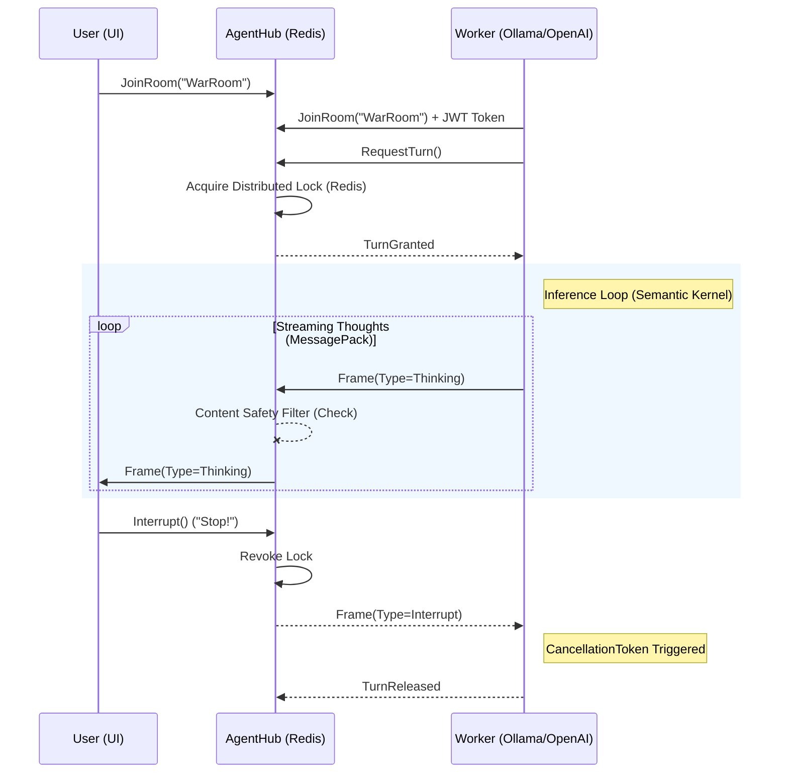

# AgentR 🧠⚡🛡️


**The Enterprise-Grade Real-time Protocol for Distributed AI Agents.**

AgentR is the "Nervous System" for multi-agent orchestration. It solves the hard distributed systems problems—concurrency, state synchronization, and remote interruptibility—so you can focus on building intelligent agents.

---

## 🌟 Why AgentR?

Most AI frameworks (Semantic Kernel, AutoGen) focus on the **Brain** (LLM reasoning). AgentR focuses on the **Network**.

| Feature | Description | Status |
| :--- | :--- | :--- |
| **Distributed Concurrency** | "Talking Stick" mutex backed by **Redis**. Only one agent speaks at a time. | ✅ v1.0 |
| **Remote Interruptibility** | Stop a runaway LLM loop instantly across the network (`CancellationToken` propagation). | ✅ v1.0 |
| **High Frequency** | Binary **MessagePack** protocol for 70% smaller payloads and sub-millisecond latency. | ✅ v1.0 |
| **Project Templates** | Scaffold new agents in seconds with `dotnet new agentr-worker`. | ✅ v1.0 |
| **Python Interop** | First-class support for Python agents via the `agentr` package. | ✅ v1.0 |
| **Enterprise Security** | **JWT Authentication** and `[Authorize]` gateways. No token, no entry. | ✅ v1.0 |
| **Governance** | "HR Department" filters. Block profanity or sensitive topics at the network level. | ✅ v1.0 |
| **Cloud Native** | Full **.NET Aspire** orchestration for one-click local cloud development. | ✅ v1.0 |

---

## 🏗️ Architecture

AgentR decouples the **Hub** (State & Governance) from the **Workers** (Intelligence).



---

## 🚀 Getting Started (The 60-Second Start)

The fastest way to join the AgentR network is to use our official project template.

### 1. Install & Scaffold
```bash
# Install the template
dotnet new install ./templates/AgentR.Worker

# Create a new agent project
dotnet new agentr-worker -n MyAgent
```

### 2. Choose Your "Brain" (LLM-Agnostic)
AgentR is a transport layer. It doesn't care which LLM you use. The `agentr-worker` template comes pre-configured with examples for:

| Provider | Integration Method |
| :--- | :--- |
| **Local LLM** | [Ollama](https://ollama.ai) (llama3.2, mistral, etc.) |
| **OpenAI** | GPT-4o, o1-preview |
| **Azure OpenAI** | Enterprise-grade deployments |
| **Anthropic** | Claude 3.5 Sonnet |
| **Custom** | Any LLM with a C# SDK |

### 3. Run Everything
Use **.NET Aspire** to spin up the entire nervous system (Redis, Hub, Content Filter) and your agent in one go:

```bash
dotnet run --project src/AgentR.AppHost/AgentR.AppHost.csproj
```

---

## 📂 Project Structure

*   **`templates/`**: The `dotnet new` templates for high-speed onboarding.
*   **`src/AgentR.Client`**: The high-performance SDK for your agents.
*   **`src/AgentR.Server`**: The Hub with Redis backplane and Content Safety.
*   **`src/AgentR.Python`**: The first-class Python interop bridge.

---

## 👩‍💻 Code Example: The Network-Aware Agent

Here is how an agent interacts with the nervous system. Note how it uses a `CancellationToken` (stopEvent) provided by the network to stop LLM inference immediately when interrupted by a human.

```csharp
client.OnTurnGranted += async (stopEvent) =>
{
    // 1. Call your Favorite LLM (Ollama, OpenAI, etc.)
    var response = kernel.InvokePromptStreamingAsync("Explain Relativity...", { 
        cancellationToken: stopEvent 
    });

    await foreach (var chunk in response)
    {
        // 2. Stream "Thoughts" to the UI instantly
        await client.EmitThinkingAsync("ResearchRoom", chunk.Text);
    }
};
```

---

## 📦 Installation

AgentR is available on NuGet:

```bash
dotnet add package AgentR.Client
```

---

We are strictly typed. We are high performance. We are distributed.
Pull Requests welcome.

## 🧪 Quality Assurance

> [!IMPORTANT]
> **Validation Note:** Integration tests validate the **Control Plane** (Locking, Interrupts, and Room Joins) using the JSON protocol for maximum polymorphic compatibility. The **Data Plane** (High-speed MessagePack serialization) is validated via the Manual Python/C# End-to-End tests in the `src/AgentR.Worker` and `src/AgentR.Python` directories.

## 📄 License

MIT