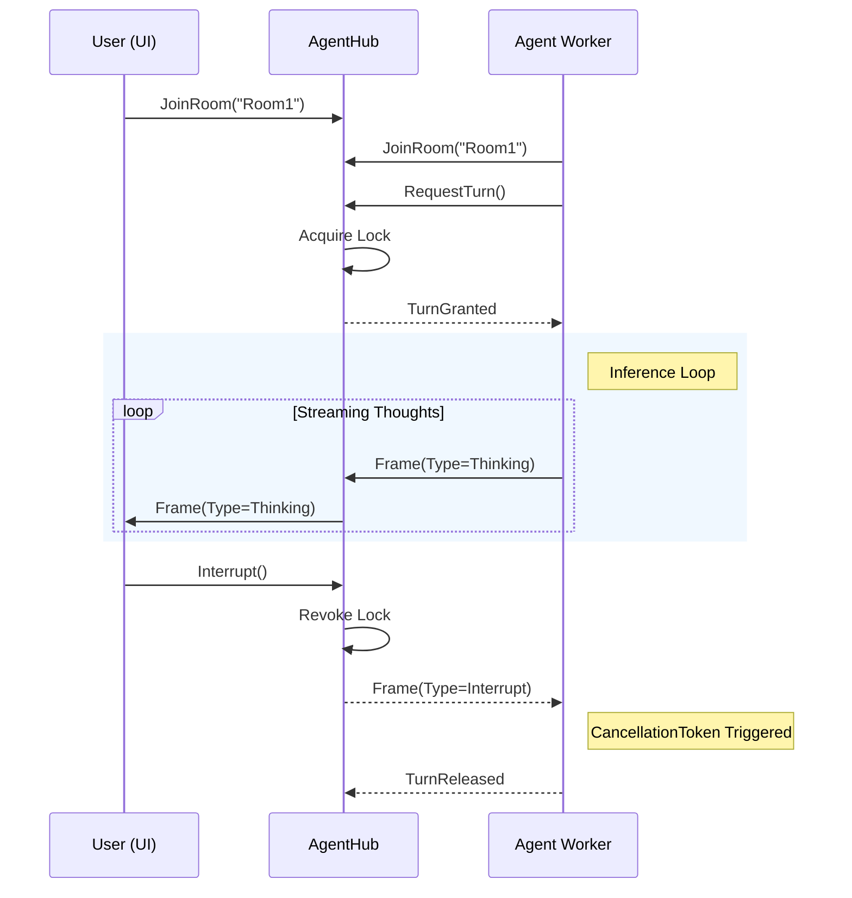

# AgentR

**A real-time transport protocol for distributed AI agent orchestration.**

AgentR provides the networking and synchronization primitives required to build multi-agent systems that span across process and network boundaries. It acts as the "nervous system" for AI, handling state synchronization, distributed concurrency, and interruptibility, allowing developers to focus on agent intelligence rather than infrastructure plumbing.

## The Problem

Current AI orchestration frameworks (Semantic Kernel, AutoGen, LangChain) primarily solve the **cognitive** layer of agentic workflows—defining how an agent reasons. However, they lack a standardized **transport** layer for distributed environments.

Deploying multi-agent systems in production introduces distributed system challenges:

* **Split-Brain States:** Multiple agents attempting to act simultaneously without a shared state of truth.
* **Latency & Observability:** Inability to stream intermediate "thought" tokens to observers in real-time.
* **Control Flow:** The inability to propagate a cancellation signal (e.g., a user clicking "Stop") to a remote agent running a long-context inference loop.

## The Solution

AgentR is a strictly typed protocol built on top of ASP.NET Core SignalR. It introduces standard synchronization primitives for the agentic lifecycle.

### Key Capabilities

* **Distributed Concurrency:** Implements a "Turn-Taking" mutex (backed by Redis or Memory) ensuring only one agent drives the conversation state at a time.
* **Interruptibility:** Native support for distributed `CancellationToken` propagation. A control frame sent by the Hub instantly triggers cancellation in the remote agent's execution loop.
* **Token Streaming:** Dedicated binary channels for high-frequency "Thinking" frames (debug/audit streams) separate from "Message" frames (commit streams).
* **Platform Agnostic:** While the reference implementation is in .NET, the protocol is serializable, allowing for future Python/Node.js interoperability.

## Architecture

AgentR decouples the **Hub** (State Manager) from the **Worker** (Intelligence).



## Getting Started

### 1. Server Setup

Configure the `AgentHub` in your ASP.NET Core host. This manages the connection lifecycle and room state.

```csharp
var builder = WebApplication.CreateBuilder(args);

// Add AgentR with in-memory state (use Redis for production)
builder.Services.AddAgentR(); 

var app = builder.Build();
app.MapAgentHub("/agentHub");
app.Run();

```

### 2. Client Implementation (The Agent)

The `AgentClient` wraps the protocol complexity. It exposes standard .NET events that integrate with Semantic Kernel or raw OpenAI clients.

```csharp
var client = new AgentClient("https://api.myapp.com/agentHub", "Reviewer-Bot");
await client.ConnectAsync();
await client.JoinRoomAsync("PR-123");

// Define behavior when this agent acquires the lock
client.OnTurnGranted += async (cancellationToken) =>
{
    try 
    {
        // Hook the network cancellation token directly into the LLM SDK
        await kernel.InvokePromptStreamingAsync(
            "Review this code...", 
            cancellationToken: cancellationToken
        );
    }
    catch (OperationCanceledException)
    {
        // Handle distributed interruption gracefully
        await client.LogAsync("Interrupted by Hub.");
    }
};

// Initiate the workflow
await client.RequestTurnAsync("PR-123");

```

## Roadmap
*open to ideas*

## Contributing

This project is currently in **Alpha**. Contributions regarding the `IAgentClient` API design and protocol specification are welcome.

## License

MIT