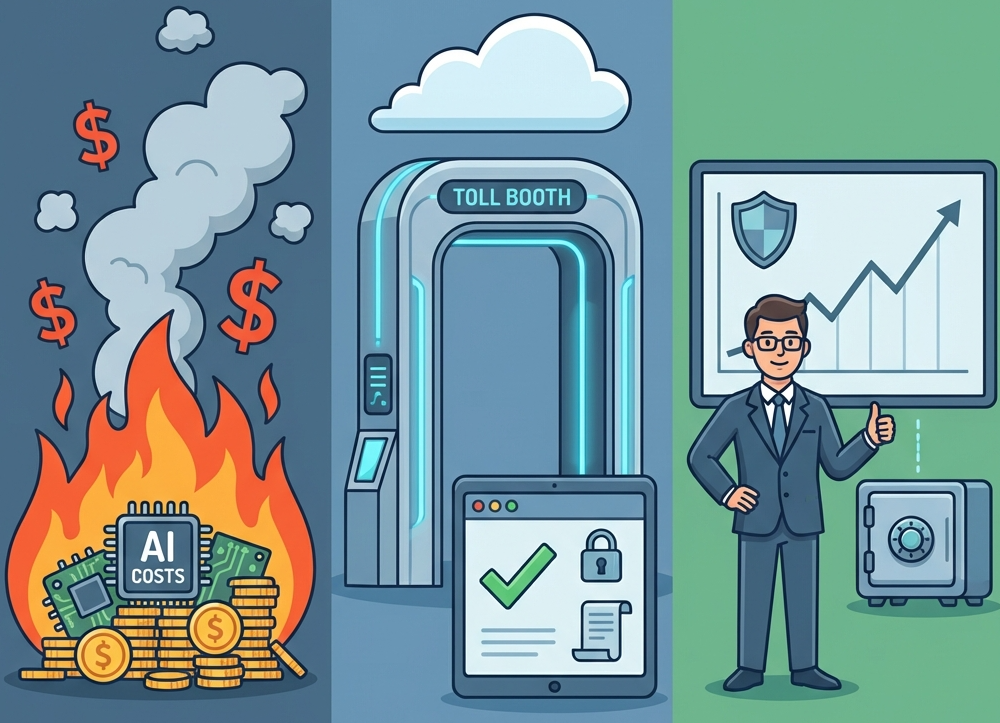

# AgentR: Executive Summary

**Product:** Distributed AI Agent Orchestration Platform
**Target:** Enterprise AI Infrastructure
**Value Proposition:** Security, Cost Control, and Reliability for Autonomous Agents.

## 1. The Business Challenge

Organizations are moving from "Chatbots" to "Agentic Workflows"—systems where multiple AI agents (Coder, Reviewer, Manager) collaborate to solve problems.
However, current open-source tools are designed for prototypes (Python notebooks), not production. When deployed to the cloud, they suffer from:

* **Runaway Costs:** Agents getting stuck in infinite loops, burning thousands of dollars in API credits.
* **Security Risks:** No "kill switch" to stop an agent that has been "jailbroken" or is hallucinating.
* **Unreliability:** Agents talking over each other, corrupting the conversation state.

## 2. The AgentR Solution

AgentR is the "Traffic Control" system for your AI workforce. It provides the missing infrastructure layer that turns experimental scripts into managed, enterprise-grade services.

### Key Capabilities:

1.  **Cost Kill-Switch:** Unlike standard API calls, AgentR allows a human or automated supervisor to instantly interrupt a running agent. This stops the billing meter immediately, preventing "runaway inference" costs.
2.  **Enterprise Governance:** Built-in "Safety Middleware" ensures that no agent can broadcast sensitive data (PII) or unsafe content to the user or other agents. It acts as a firewall for AI output.
3.  **Auditability (Flight Recorder):** Every "thought" and decision made by an agent is traced and logged. Immutable audit trails are stored in high-performance local or cloud storage (Azure Blob).
4.  **Scale-to-Zero (KEDA)**: Event-driven autoscaling via the Lobby pattern (Redis-backed). Infrastructure only spins up when a request is active, enabling extreme cloud-cost efficiency.
5.  **FinOps (Budget Controller)**: Atomic credit system to prevent costly runaway agent loops.
6.  **Immutable Log Trails**: Every frame (Thinking, Messaging, Turns) is captured and hashed.
7.  **Session Replay:** A millisecond-accurate replay UI allows auditors to "watch the tape" of a past conversation to understand agent context and hallucinations.
8.  **MCP Gateway**: Secure "connectivity layer" for agents to access databases and APIs without exposing infrastructure keys to model providers.
9.  **Vendor Neutrality:** Works with Azure OpenAI, local Ollama models (for privacy), and Python-based agents, preventing vendor lock-in.

## 3. Strategic Comparison

| Feature | Standard "Chat" Implementation | AgentR Platform |
| --- | --- | --- |
| **State Management** | Fragile (In-Memory). Breaks if server restarts. | **Resilient (Redis Backplane).** Survives crashes. |
| **Control** | Passive. You wait for the AI to finish. | **Active.** You can interrupt the AI mid-sentence. |
| **Security** | None. Agents trust each other implicitly. | **Zero Trust.** Every message is authenticated & scanned. |
| **Room Discovery** | N/A | Dynamic agent assignment and metadata discovery. |
| **FinOps** | N/A | Quota management to prevent runaway LLM costs. |
| **Auditing** | Ephemeral logs (Console/Terminal). | **Persistent & Replayable.** Immutable "Flight Data" with cloud storage. |
| **Scale** | Single Server (Prototype only). | **Horizontal Scale.** Ready for Kubernetes/Azure Container Apps. |

## 4. ROI & Roadmap

* **Next Steps:** Expansion of the Session Replay UI for advanced analytics and formal deployment templates for Azure Container Apps (ACA).

## 5. Conclusion

AgentR transforms AI Agents from "unpredictable scripts" into "managed employees." It provides the necessary controls to deploy multi-agent systems with confidence, ensuring they remain safe, cost-effective, and obedient to human command.