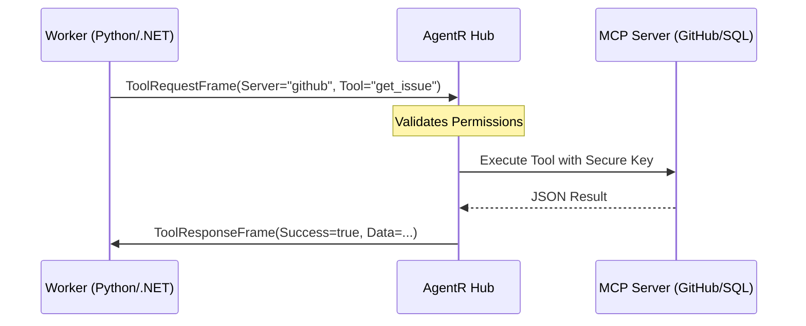

# AgentR: MCP Gateway (Connectivity Layer)

The AgentR MCP Gateway enables secure, standardized tool execution for AI agents. By integrating the **Model Context Protocol (MCP)**, AgentR allows agents to "borrow" server-side capabilities (like database access or API integrations) without requiring direct access to sensitive credentials.

## 1. The Problem: "The Secret Leak"
Normally, giving an agent "hands" (tools) requires:
1.  Hardcoding API keys into the agent environment.
2.  Writing custom plugin logic for every new tool.
3.  Trusting that the agent won't accidentally leak or misuse the keys via prompt injection.

## 2. The Solution: AgentR as the MCP Gateway
AgentR acts as the **Gateway**. Instead of the Agent holding the keys, the **Hub** holds them and runs the MCP Client.

### Architecture


## 3. Key Benefits
- **Zero-Trust Tooling:** Agents never see API keys.
- **Unified Interface:** Use existing community MCP servers (Stripe, GitHub, Slack) out of the box.
- **Governance:** Apply `[Authorize]` attributes or SignalR filters to control which agents can use which tools.

## 4. Usage Example

### .NET Client
```csharp
var resultJson = await client.CallToolAsync(
    roomId: "Dev-Room", 
    server: "github", 
    tool: "get_issue", 
    args: new { id = 42 }
);
```

### Python Client
```python
request_id = client.invoke_tool(
    room_id="Dev-Room",
    server="github",
    tool="get_issue",
    args={"id": 42}
)
# Result is received asynchronously via signal handler
```

## 5. Security & Isolation
The Hub implementation of the MCP Gateway allows for strict isolation. You can run MCP Servers as sidecar containers in your Kubernetes cluster, and only the AgentR Hub has the network permission to reach them. The agents themselves are totally isolated from the data layer.
