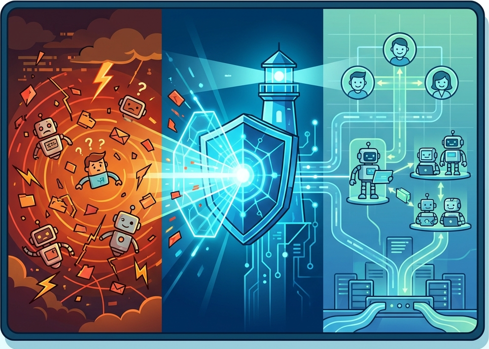

# AgentR: Technical Architecture Summary


**Version:** 1.0.0
**Stack:** .NET 9, SignalR, Redis, KEDA, MessagePack
**License:** MIT

## 1. Overview

AgentR is a specialized real-time transport protocol designed to solve the "Orchestration Gap" in distributed multi-agent systems. While frameworks like Semantic Kernel and LangChain solve the *cognitive* layer (prompt engineering), AgentR solves the *networking* layer. It provides synchronization primitives—locks, interrupts, and streams—over a binary WebSocket protocol.

## 2. Core Architecture

The system follows a Hub-and-Spoke topology where the **AgentHub** acts as the authoritative state manager for distributed agents (Workers).

### 2.1 The "Nervous System" Topology

* **Hub (Server):** An ASP.NET Core service that manages connection lifecycles, authenticates agents, and enforces room policies.
* **Backplane (Redis):** Uses `StackExchange.Redis` for pub/sub messaging across scaled server instances and `Medallion.Threading.Redis` for distributed locking.
* **Worker (Client):** A lightweight SDK (available in .NET and Python) that wraps the protocol and exposes events (`OnTurnGranted`, `OnInterrupt`).

### 2.2 The Protocol (Binary MessagePack)

To ensure high throughput for token streaming, AgentR bypasses JSON in favor of **MessagePack**. This reduces payload size by ~60% compared to standard SignalR text frames.

**Frame Types:**

* `TurnGrantedFrame`: Signals that a client has acquired the distributed mutex.
* `ThinkingFrame`: High-frequency, low-latency stream of intermediate tokens (LLM generation).
* `MessageFrame`: The final, committed response from an agent.
* `InterruptFrame`: A high-priority control signal that triggers immediate cancellation.
* `AuditRecord`: A metadata-rich wrapper for long-term storage of all of the above.

## 3. Key Technical Innovations

### 3.1 Distributed Concurrency (The "Split-Brain" Fix)

Standard chat apps rely on in-memory state. AgentR implements a **Distributed Mutex** pattern.

*   **Mechanism:** When an agent requests to speak, the Hub attempts to acquire a Redis Redlock key (`lock:room:{id}`).
*   **TTL:** Locks have a strict Time-To-Live. If an agent crashes (Zombie Process), the lock automatically expires, unblocking the room.
*   **Rejection:** If the lock is held, the Hub immediately rejects competing requests with a `BUSY` signal, preventing race conditions.
*   **Reactive Signaling:** To avoid network polling (spin-locks), the Hub broadcasts a `FloorOpenFrame` whenever a turn is released. This allows waiting agents to be "woken up" instantly to request their turn, optimizing both latency and credit consumption.
*   **Idempotency & Room Steering:** `JoinRoom` is now fully idempotent per connection. If an agent switches rooms on the same connection, the Hub automatically decrements the old room's count and removes the connection from the previous SignalR group before joining the new one, ensuring zero state leakage.
*   **WatchDog (Lease Monitor):** A server-side background task monitors lock duration (default 60s). It forcibly revokes locks if an agent hangs, preventing deadlocks. Computes can opt-out by setting `AgentR:LeaseTimeoutSeconds` to `0`.

### 3.2 True Interruptibility (The "Stop Button")

AgentR bridges the gap between the Network and the CPU.

* **Result:** This physically stops the compute loop on the worker node, saving GPU cycles and API costs immediately.

### 3.3 Governance Middleware

AgentR introduces an `IHubFilter` pipeline for agent communications:

1.  **Auth Layer:** Validates JWTs via Query String (WebSocket standard).
2.  **Safety Layer:** Intercepts `Broadcast` calls and scans content against a "Banned Word" list or Azure AI Content Safety API before relaying to the room.
3.  **FinOps Layer (Budget Controller):** Atomic credit system to prevent costly runaway agent loops.
4.  **Connectivity Layer (MCP Gateway):** Secure "USB Cable" for agents to access GitHub, Slack, and Databases via the Hub, keeping API keys centralized and safe.
5.  **Observability Layer:** Emits OpenTelemetry spans for every turn, allowing distributed tracing in .NET Aspire.

### 3.4 Secure Tool Connectivity (MCP Gateway)

AgentR implements a **native, process-based client** for Anthropic's Model Context Protocol.

*   **Dynamic Configuration:** Servers are defined in a standard `mcp.json` file, easing integration with existing MCP ecosystems.
*   **Infrastructure-as-Code:** Tool definitions and commands are version-controlled alongside the application.
*   **RPC Routing:** Agents request tool execution via `InvokeTool`. The Hub validates the request, spins up the configured process (if needed), executes the tool via standard input/output (Stdio), and relays the result.
*   **Security:** This keeps API keys centralized on the Hub and prevents sensitive credentials from leaking to agent environments.

## 4. FinOps & Quota Management

AgentR introduces a "Toll Booth" model to prevent the "Intern runaway loop" scenario.

*   **Mechanism:** Every Room has a "Wallet" stored in Redis. The Hub intercepts every `RequestTurn` and `Broadcast` call.
*   **Atomic Costing:** Uses Redis `DECR` and `INCR` to ensure thread-safe balance management across multi-node Hub deployments.
*   **Kill Switch:** If a room's balance is insufficient, the Hub rejects the call with a `402 Payment Required` HubException, instantly stopping the agent's logic flow.
*   **Pricing Model:** 5 credits per Turn, 1 credit per Thought/Message Frame.

## 5. KEDA Autoscaling (The "Lobby Pattern")

AgentR introduces native support for **Scale-to-Zero** cloud economics via the Lobby Pattern.

*   **Demand Signaling:** When a client requires a specific agent type (e.g., "python-analyst"), the Hub pushes a ticket to a Redis list (`agentr:lobby:python`).
*   **KEDA Integration:** A Kubernetes `ScaledObject` monitors the Redis list length. If the list is non-empty, KEDA spins up the required agent pods.
*   **Stateless Persistence:** Once the pod is live, the agent pops the ticket, fulfills the request, and disconnects. This allows the pod to be terminated by KEDA after a cooldown period, reducing idle compute costs to $0.

## 6. Integration

The SDK integrates natively with **Microsoft.SemanticKernel**:

```csharp
// The "Network Aware" Inference Call
await kernel.InvokeWithNetworkStreamingAsync(
    prompt, 
    agentClient, 
    roomId, 
    cancellationToken // Linked directly to the AgentR Interrupt signal
);

```

## 7. Performance Metrics

*   **Latency:** <15ms overhead for message relay (excluding network travel).
*   **Throughput:** Capable of handling 10k+ concurrent agent streams per Hub instance (dependent on Redis IOPS).
*   **Payload:** ~70% reduction in bandwidth usage vs. JSON-based orchestration.

## 8. Testing & Validation

**📝 Protocol Validation Strategy:** 
To maintain high velocity and reliable test results, the automated Integration Test suite of **32+ tests** (xUnit/Testcontainers) validates both the Control and Data planes:

1.  **Distributed Consistency**: Tests for unique identity tracking, reference-counted agent counts, and room-switching logic.
2.  **Safety & Governance**: `SafetyTests` and `BudgetTests` specifically target the interceptor pipeline for content and financial enforcement.
3.  **Cross-Platform Fidelity**: The **Data Plane** (MessagePack binary serialization) is validated through cross-platform E2E tests between the .NET reference worker and the Python client, ensuring that polymorphic frames are correctly tagged and parsed across different memory layouts.
4.  **Resiliency**: Stress tests for "Zombie Processes" (Watchdog) and hard socket disconnects.


